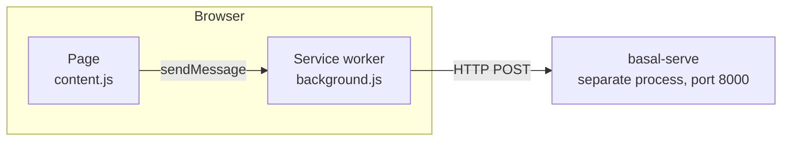
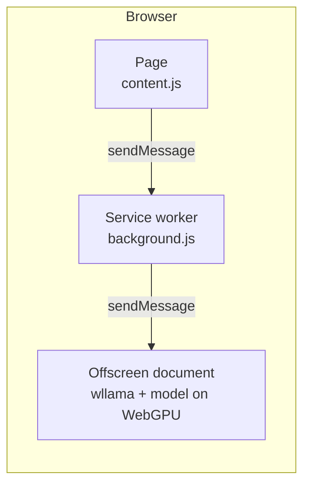
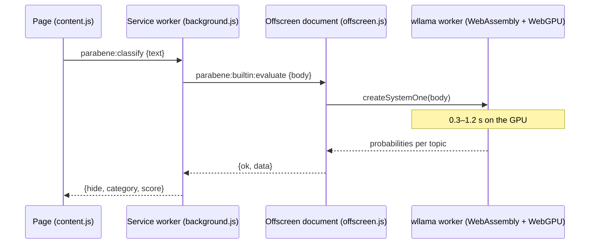
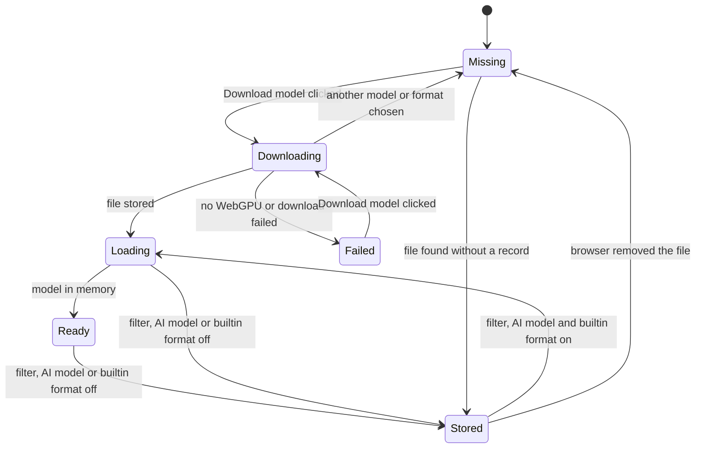

# ParaBene – Positive Web & News Filter

**ParaBene** is a lightweight Google Chrome extension (Manifest V3) that hides posts and articles with unwanted content — profanity, accidents, violence and negative sensationalism — on news portals and social media, with special focus on Facebook.

Hidden content does not disappear from the page: it collapses into an unobtrusive bar

> ParaBene ukryło treść (powód: wypadek) **[Pokaż mimo wszystko]**
> *(ParaBene hid this content (reason: accident) [Show anyway])*

so it can be revealed with a single click in case of a false positive. With the optional [learning](#learning-from-revealed-content) on, ParaBene remembers what you revealed and lets similar content through.

- Plain JavaScript, HTML and CSS — **no `npm install`, no bundler, no build step**. The only third-party code is [wllama](https://github.com/ngxson/wllama) (llama.cpp in WebAssembly, MIT), kept in `vendor/wllama/` for the optional [built-in model](#built-in-model-no-server).
- Everything runs locally. Page text never leaves your machine or home network (the optional AI model runs in the browser itself, on `localhost` or on a server you choose in your LAN); the same goes for pictures with the optional image evaluation.
- Modular decision engine, ready for plugging in a local AI model (Stage 2).

> The user interface is available in **Polish (default) and English** — switch it with the language picker in the panel's footer. The default keyword list is Polish, as ParaBene targets Polish-language websites.

---

## Installation (Linux / Windows / macOS)

The procedure is the same on every system:

1. Get the repository:
   ```bash
   git clone https://github.com/danieljarosik/parabene.git
   ```
   or download the ZIP from GitHub and extract it.
2. Open `chrome://extensions` in Chrome.
3. Turn on **Developer mode** in the top-right corner.
4. Click **Load unpacked** and select the `parabene` directory (the one containing `manifest.json`).
5. Pin the umbrella icon to the toolbar (puzzle icon → pin next to ParaBene).
6. Reload open tabs — the extension works on pages loaded after installation.

The extension also works in other Chromium-based browsers (Edge, Brave, Opera, Vivaldi), via the same extensions page.

**Updating:** after `git pull`, click the reload icon next to ParaBene in `chrome://extensions` and reload your tabs.

---

## Usage

Click the ParaBene icon to open the panel. Labels below are given in English, with the Polish (default) UI text in parentheses.

| Element | What it does |
| --- | --- |
| **ON/OFF** switch | Instantly enables or disables the filter in all tabs. When disabled, hidden content comes back. |
| **Hidden on this page** (*Ukryte na tej stronie*) | Number of collapsed elements in the current tab (also shown as a badge on the extension icon), split into **Keywords** (*Słowa kluczowe*), **AI (text)** (*AI (tekst)*) — the text model — and **AI (picture)** (*AI (grafika)*) — the image model. Content hidden by keywords while the AI model is unavailable counts as keywords. The placeholder bar says the same: *AI – text* (*AI – tekst*) or *AI – picture* (*AI – grafika*) after the reason. With learning on, **Let through (learned)** (*Przepuszczone (nauka)*) counts content let through by learned examples. |
| **Keywords** (*Słowa kluczowe*) | Add phrases (several at once — separate them with commas) and remove them with a single click on `×`. Changes apply immediately, without reloading the page. |
| **Restore default phrases** (*Przywróć domyślne frazy*) | Adds missing phrases from the default list (does not remove yours). |
| **Local AI model (localhost)** (*Lokalny model AI*) | Switches evaluation to a local AI model: a classification server you run or the built-in model. **Request format** (*Format zapytań*) picks ParaBene's simple contract, [basal-serve](#basal-serve-v1basal) or the [built-in model](#built-in-model-no-server) (*Wbudowany model*), which needs no server; the address field (hidden for the built-in model) and the **Test** (*Testuj*) button check the connection. **Keywords and AI model** (*Frazy i model AI*) sets how the two work together (see below); with basal-serve or the built-in model you also pick the **Sensitivity** (*Czułość*) and the **Hidden topics** (*Ukrywane tematy*). |
| **Image evaluation (basal-omni)** (*Ocena grafik (basal-omni)*) | Off by default. Judges the pictures of posts and tiles with a multimodal model on a separate basal-serve server (e.g. port 8011), so the fast text model keeps its own. Works with or without the text model, shares its **Sensitivity** and **Hidden topics**; **Test** (*Testuj*) checks that the server takes images. See [Image evaluation](#image-evaluation-basal-omni). |
| **Learning** (*Samouczenie*) | Off by default. **Learn from revealed content** (*Ucz się z odkrytych treści*): content you reveal and do not hide again becomes an example, and similar content hidden for the same reason is let through under a **Hide** (*Ukryj*) bar. **How similar content to let through** (*Jak podobne treści przepuszczać*) sets the similarity; the list of learned examples lets you forget them one by one or all at once. See [Learning from revealed content](#learning-from-revealed-content). |
| **Log of hidden content** (*Dziennik ukrytych treści*) | Off by default. When on, every hidden item is recorded locally with its text, page address and verdict (keywords, AI text model or AI image model); **Download file (.jsonl)** (*Pobierz plik*) exports it for analysis, **Clear log** (*Wyczyść dziennik*) deletes it (click twice). See [Log of hidden content](#log-of-hidden-content). |
| Language picker (footer, 🌐) | Switches the interface language (*Polski* / *English*). It applies at once to the panel and to the placeholder bars in open tabs, without reloading them. |

Profanity on the panel's keyword list is blurred and revealed on mouse hover. The placeholder bar shows the category *profanity* („wulgaryzm”) instead of the word itself.

### How keyword matching works

- Case-insensitive, with full support for Polish characters (`ą ć ę ł ń ó ś ź ż`) — „ŚMIERĆ” matches „śmierć”.
- A phrase must match **at the start of a word**, and its end is open. Entering a word stem therefore covers inflected forms:
  - `tragedi` → tragedia, tragedii, tragedię,
  - `pożar` → pożar, pożaru, pożarami,
  - but `pożar` will **not** match „rozpożarowanie”, and `wypadek` will not match „x_wypadek”.
- Multi-word phrases (`nie żyje`) tolerate any whitespace between words.
- Short phrases (min. 3 characters) catch a lot — the shorter the stem, the higher the risk of false positives.

On first run, a default list of Polish phrases is loaded (accidents, death, violence, disasters, basic profanity). You can edit it freely.

---

## How ParaBene finds content

**Facebook** — CSS classes there are randomly generated, so ParaBene relies solely on the accessibility structure: `div[role="article"]`, feed items (`div[role="feed"] > div`) and `div[aria-posinset]`. Each container is evaluated only on its **own** text — a profane comment hides just that comment, not the whole post.

**News portals and other sites** — `<article>` / `role="article"` elements and tiles built around an `h1`–`h3` heading with a link (the algorithm climbs from the heading to the largest ancestor that is still a single tile). Safeguards reject `body`, `main`, the feed, navigation, the page header and footer, as well as containers holding many articles or too much text, so the whole page never gets hidden.

**Dynamically loaded content** (infinite scroll) is handled by a `MutationObserver` with a 200 ms debounce (and a 1 s maximum wait under a continuous stream of changes). Checked nodes get the `data-parabene-checked="true"` attribute. If their text changes (e.g. Facebook first renders an empty post skeleton) or part of it is removed, they are evaluated again; a picture added to a post whose text did not change is judged too (with image evaluation on). Text split by inline formatting (`<strong>wypa</strong>dek`) is read as one word. **Show anyway** applies to the content you revealed: if the page reuses the element for different content, it is filtered again (small changes such as reaction counters or "See more" keep it revealed). Turning the filter or the AI model off drops the requests still waiting in the queue — no text or picture is sent after that.

**Hiding** never uses `.remove()` — that would break infinite scroll and page scripts. The container gets the `parabene-hidden` class, and CSS hides its children and shows the placeholder bar inserted as the first child.

---

## Architecture

```
parabene/
├── manifest.json          Manifest V3 (name/description via __MSG_*__, default_locale: pl)
├── .env.example           template of the local settings file .env (not committed)
├── _locales/
│   ├── pl/messages.json   Polish UI texts (default)
│   └── en/messages.json   English UI texts
├── icons/                 icon16/48/128.png (generated by tools/generate_icons.py)
├── src/
│   ├── config.js          default settings, phrase list, chrome.storage.local access
│   ├── i18n.js            translation loader/formatter (placeholders, plural forms, DOM localization)
│   ├── evaluators.js      ContentEvaluator, KeywordEvaluator, LocalAIEvaluator, FallbackEvaluator
│   ├── learning.js        similarity of texts for learning from revealed content
│   ├── content.js         MutationObserver, container heuristics, hiding/restoring, "Hide" bars
│   ├── content.css        styles for hidden blocks and the placeholder bar
│   └── background.js      service worker: default settings, local AI proxy (text and pictures), the built-in model's offscreen document, icon badge counter, log, learned examples, translations for content scripts
├── offscreen/
│   ├── offscreen.html     background page of the built-in model (never shown)
│   └── offscreen.js       loads the model with wllama and answers the service worker
├── popup/
│   ├── popup.html
│   ├── popup.css
│   └── popup.js
├── vendor/
│   └── wllama/            wllama 3.13.0 (MIT), written by tools/vendor_wllama.py
└── tools/
    ├── generate_icons.py  icon generator (plain Python, no libraries)
    ├── check_locales.py   translation consistency check (plain Python, no libraries)
    ├── basal_check.py     basal-serve check and reference client (plain Python, no libraries)
    └── vendor_wllama.py   downloads wllama and writes vendor/wllama/ (plain Python, no libraries)
```

`content.js` deals with the DOM only. Whether to hide a piece of text is decided by an evaluator from `evaluators.js` through a shared contract:

```js
class ContentEvaluator {
  async evaluate(text) // → { hide: boolean, reason: string, source: "keyword" | "ai", category?: string,
                      //     details?: { score, threshold, probabilities, model }, fallback?: true }
}
```

`details` carries the AI model's numbers and `fallback` marks a keyword verdict given while the model was unavailable; both are used only by the log of hidden content. Evaluators are language-neutral: `reason` is raw data (the matched phrase or the model's own text) and `category` is an id such as `profanity`. The UI turns them into text in the chosen language; errors from the local model are likewise passed around as `{ code, detail }` and translated by the panel.

| Class | Role |
| --- | --- |
| `KeywordEvaluator` | Fast local keyword matching (a single compiled regular expression with the `u` flag). |
| `LocalAIEvaluator` | Sends a `POST` to the local endpoint. Limits concurrent requests (3), caches results and caps text length (2000 characters). When a request fails, the ones still queued fail with it, so a server that hangs is not asked again for each of them. `cancel()` drops the queued requests when the settings change. |
| `FallbackEvaluator` | Tries the AI model. On error (no server, the built-in model still loading, timeout, invalid response) it falls back to `KeywordEvaluator` and skips the failing model for 30 s. |
| `FirstHitEvaluator` | Asks evaluators in order and stops at the first one that hides the text. Used by the default *Keywords + AI* mode: a keyword match hides at once, without a request to the model. |

**Keywords and AI model** (`aiMode`):

- `both` (default, *Frazy + AI*) — your keywords still work with the model on: a match hides the text at once; everything else goes to the model. Profanity and your own phrases are never missed because the model was not asked about them.
- `ai` (*Tylko AI*) — the model decides alone; keywords are used only while the model is unavailable.

All settings live in `chrome.storage.local`:

```json
{
  "enabled": true,
  "keywords": ["wypadek", "śmierć", "..."],
  "aiEnabled": false,
  "aiEndpoint": "http://localhost:8000/classify",
  "aiProtocol": "simple",
  "aiModel": "basal-2.0-mini-q5",
  "aiMode": "both",
  "aiSensitivity": "medium",
  "aiTopics": ["accident", "violence", "death", "profanity"],
  "aiImagesEnabled": false,
  "aiImagesEndpoint": "http://localhost:8011",
  "logEnabled": false,
  "learnEnabled": false,
  "learnSimilarity": "medium",
  "language": "pl"
}
```

### Local settings file (`.env`)

To keep your own settings (e.g. the address of a server in your LAN) out of git, copy `.env.example` to `.env` in the extension directory and edit it. `.env` is ignored by git.

```bash
cp .env.example .env
```

```ini
PARABENE_AI_ENABLED=true
PARABENE_AI_PROTOCOL=basal
PARABENE_AI_ENDPOINT=http://192.168.1.170:8010
PARABENE_AI_SENSITIVITY=medium
PARABENE_AI_TOPICS=accident,violence,death,profanity,politics
PARABENE_AI_IMAGES_ENABLED=true
PARABENE_AI_IMAGES_ENDPOINT=http://192.168.1.170:8011
```

The service worker reads `.env` on install and on every reload of the extension in `chrome://extensions`, and writes the values into `chrome.storage.local`. So edit `.env`, then reload the extension. Changes made in the panel last until the next reload. `PARABENE_AI_PROTOCOL` given without `PARABENE_AI_ENDPOINT` also switches an endpoint that is still a default one to that protocol's default address (as the panel does). Supported keys: `PARABENE_ENABLED`, `PARABENE_AI_ENABLED` (`true`/`false`), `PARABENE_AI_PROTOCOL` (`simple`/`basal`/`builtin`), `PARABENE_AI_ENDPOINT`, `PARABENE_AI_MODEL` (a built-in model's id, see [Models](#models)), `PARABENE_AI_MODE` (`both`/`ai`), `PARABENE_AI_SENSITIVITY` (`low`/`medium`/`high`), `PARABENE_AI_TOPICS` (comma-separated ids from `accident`, `violence`, `death`, `profanity`, `politics`, `clickbait`; empty = none), `PARABENE_AI_IMAGES_ENABLED` (`true`/`false`), `PARABENE_AI_IMAGES_ENDPOINT`, `PARABENE_LOG_ENABLED` (`true`/`false`), `PARABENE_LEARN_ENABLED` (`true`/`false`), `PARABENE_LEARN_SIMILARITY` (`strict`/`medium`/`loose`) and `PARABENE_LANGUAGE` (`pl`/`en`). Unknown keys and invalid values are skipped with a warning in the service worker console. Without a `.env` file nothing changes.

### Internationalisation (i18n)

UI texts use the standard Chrome extension format — [`_locales/<lang>/messages.json`](https://developer.chrome.com/docs/extensions/reference/api/i18n) — with a `description` for translators and named placeholders with examples for every message. Nothing user-visible is hard-coded in HTML or JavaScript.

- **Manifest** strings (`__MSG_extName__`, `__MSG_extDescription__`) are resolved by Chrome from the browser language, falling back to `default_locale` (`pl`).
- **Panel and placeholder bars** follow the `language` setting chosen by the user (default `pl`). `chrome.i18n.getMessage()` cannot switch language at runtime, so `src/i18n.js` loads the chosen `messages.json` and formats it with the same rules as `chrome.i18n` (`$name$` placeholders, `$1…$9`, `$$`, case-insensitive names). Missing keys fall back to the default language, then to `chrome.i18n`.
- **Plural forms** follow CLDR rules via `Intl.PluralRules`: `plural('keywordsAdded', n)` picks `keywordsAdded_one` / `_few` / `_many` / `_other` (Polish needs all four: 1 frazę, 2 frazy, 5 fraz). Numbers are formatted with `Intl.NumberFormat`.
- **HTML** is translated declaratively: `data-i18n="key"` sets the text, `data-i18n-placeholder`, `data-i18n-title`, `data-i18n-aria-label` and `data-i18n-alt` set attributes; `<html lang/dir>` and the bar's `lang` attribute follow the UI language.
- **Content scripts** cannot read extension files, so they get translations from the service worker (`parabene:getMessages`).

**Adding a language** (e.g. German):

1. Copy `_locales/en/messages.json` to `_locales/de/messages.json` and translate every `message` (keep the keys and placeholders; add `_one`/`_few`/`_many`/`_other` variants as German plural rules require — `_other` is always the fallback).
2. Add `de: 'Deutsch'` to `UI_LANGUAGES` in `src/config.js` (the name is written in the language itself).
3. Run `python3 tools/check_locales.py`.

---

## Local AI endpoint contract (Stage 2)

With **Local AI model (localhost)** (*Lokalny model AI*) enabled, every detected container is evaluated by your server. Requests are sent by the extension's service worker, so **the server does not need to set CORS headers**, and pages' private network restrictions (HTTPS → localhost) do not apply.

**Request**

```http
POST /classify HTTP/1.1
Host: localhost:8000
Content-Type: application/json

{"text": "Tragiczny wypadek na autostradzie A4. Trzy osoby ranne."}
```

- `text` — text of the post or tile (UTF-8, whitespace normalized, max. 2000 characters).

**Response** (`200 OK`, `Content-Type: application/json`)

```json
{"hide": true, "reason": "wypadek drogowy"}
```

| Field | Type | Required | Description |
| --- | --- | --- | --- |
| `hide` | `boolean` | yes | `true` — hide the content. |
| `reason` | `string` | no | Short reason shown in the bar (truncated to 80 characters). Defaults to *AI model verdict* („ocena modelu AI”), in the UI language. |

**Error handling:** a non-`2xx` response, invalid JSON, a missing `hide` field or no response within **4 s** make ParaBene fall back to keywords, and the server is skipped for 30 s. Pages keep working normally even when the server is down.

### Example server (Python, no dependencies)

```python
# classify_server.py — run: python3 classify_server.py
import json
from http.server import BaseHTTPRequestHandler, HTTPServer

NEGATIVE = ("wypadek", "zginął", "tragedi", "przemoc")

class Handler(BaseHTTPRequestHandler):
    def do_POST(self):
        if self.path != "/classify":
            self.send_error(404)
            return
        length = int(self.headers.get("Content-Length", 0))
        text = str(json.loads(self.rfile.read(length) or b"{}").get("text", "")).lower()
        hit = next((word for word in NEGATIVE if word in text), None)
        body = json.dumps({"hide": hit is not None, "reason": hit or ""}, ensure_ascii=False).encode()
        self.send_response(200)
        self.send_header("Content-Type", "application/json; charset=utf-8")
        self.send_header("Content-Length", str(len(body)))
        self.end_headers()
        self.wfile.write(body)

HTTPServer(("127.0.0.1", 8000), Handler).serve_forever()
```

Test from the terminal:

```bash
curl -s -X POST http://localhost:8000/classify \
  -H 'Content-Type: application/json' \
  -d '{"text": "Tragiczny wypadek na A4"}'
# {"hide": true, "reason": "wypadek"}
```

### Plugging in a real model

- **Polish classifier (HerBERT, Bazal, etc.)** — call your pipeline in `do_POST` (e.g. `transformers.pipeline("text-classification", model=...)`) and return `{"hide": label in NEGATIVE_LABELS, "reason": label}`.
- **Ollama / llama.cpp** — both have their own APIs, so put a thin adapter in front of them that speaks the same format. Example for Ollama:

  ```python
  import json, urllib.request

  def classify_with_ollama(text):
      prompt = (
          "Decide whether the following text contains violence, accidents, death, profanity or "
          "negative sensationalism. Reply with JSON only: "
          '{"hide": true|false, "reason": "short reason in Polish"}.\n\nText: ' + text
      )
      request = urllib.request.Request(
          "http://localhost:11434/api/generate",
          data=json.dumps({"model": "llama3.1", "prompt": prompt, "format": "json", "stream": False}).encode(),
          headers={"Content-Type": "application/json"},
      )
      with urllib.request.urlopen(request, timeout=3.5) as response:
          answer = json.loads(json.loads(response.read())["response"])
      return {"hide": bool(answer.get("hide")), "reason": str(answer.get("reason", ""))}
  ```

  The model must respond within 4 s. On slower hardware, pick a smaller model.

Set the endpoint address in the panel (the **Endpoint URL** (*Adres endpointu*) field). The **Test** (*Testuj*) button sends a sample text and shows the server's response.

### basal-serve (`/v1/basal`)

Instead of writing an adapter, pick **basal-serve (/v1/basal)** under **Request format** (*Format zapytań*) and enter the server address, e.g. `http://192.168.1.170:8010` (`/v1/basal` is appended to a bare address; a full route such as `http://192.168.1.170:8010/v1/basal` also works). A 404 from the server shows a hint about the path and the request format. ParaBene then speaks basal's typed-decision API directly (tested with `Remek/basal-2.0-mini-MLX-8bit`). Each container is one request with one `choice` question:

```json
{
  "state": "Wypadek na S6 koło Żukowa, dwa auta rozbite, korek na 4 km.",
  "lang": "pl",
  "questions": {
    "topic": {
      "type": "choice",
      "instructions": "Co opisuje tekst?",
      "option_keys": "hide",
      "criteria": {
        "accident": "wypadek, katastrofę, pożar lub klęskę żywiołową",
        "violence": "przemoc, przestępstwo, atak lub wojnę",
        "death": "śmierć, chorobę lub tragedię osobistą",
        "profanity": "wulgaryzmy lub obelgi",
        "none": "coś innego, neutralnego lub pozytywnego"
      }
    }
  }
}
```

```json
{"model": "basal-2.0-mini-MLX-8bit",
 "answers": {"topic": {"type": "choice", "choice": "accident",
   "probabilities": {"accident": 0.57, "violence": 0.02, "death": 0.01, "profanity": 0.01, "none": 0.39},
   "confidence": 0.57}},
 "usage": {"input_tokens": 112, "questions": 1, "latency_ms": 160}}
```

**Hidden topics** (`aiTopics`) pick which topics count; the bar shows the most probable selected topic, e.g. *(powód: wypadek, AI)*.

| Topic id | Panel label | Description sent to the model | Default |
| --- | --- | --- | --- |
| `accident` | *wypadek* (accident) | wypadek, katastrofę, pożar lub klęskę żywiołową | ✓ |
| `violence` | *przemoc* (violence) | przemoc, przestępstwo, atak lub wojnę | ✓ |
| `death` | *śmierć lub tragedia* (death or tragedy) | śmierć, chorobę lub tragedię osobistą | ✓ |
| `profanity` | *wulgaryzm* (profanity) | wulgaryzmy lub obelgi | ✓ |
| `politics` | *polityka* (politics) | politykę, polityków lub spory polityczne | |
| `clickbait` | *sensacja / clickbait* (sensationalism / clickbait) | sensację, szokujący nagłówek lub clickbait | |

The four default topics are always part of the question, even when unchecked: with only one or two options the model gets pushed into them (asked about politics alone, a profane rant scored p(politics) ≈ 0.8). `politics` and `clickbait` are added only when checked, as they draw probability away from the others (with `clickbait` present, a flood report scored only 0.24 for the disaster topics).

The **hide score** is the summed probability of the checked topics. **Sensitivity** (`aiSensitivity`, `AI_SENSITIVITIES` in `src/config.js`) sets the threshold: *low* 0.7, *medium* 0.5 (default), *high* 0.3. The **Test** (*Testuj*) button shows the score of its sample text and the threshold, which helps when tuning it. On a set of 20 Polish news snippets the defaults at *medium* hid all 10 about accidents, disasters, crime, death and profanity, and none of the 10 neutral, political or merely sensational ones. The choice form is used because a plain yes/no (`noul`) question ranks texts well but is poorly calibrated on this model (a car crash scored p(true) ≈ 0.3). `max_error` / `abstain` are not used: this model certifies only `choice` at `max_error` 0.05, with a confidence threshold of ≈ 0.97, so nearly every answer abstains.

Warm requests take ~150–300 ms. Check a server and see the raw contract with the bundled script, which also contains a reusable client (`BasalClient`):

```bash
python3 tools/basal_check.py --url http://192.168.1.170:8010
```

### Built-in model (no server)

Pick **Built-in model (in the browser, WebGPU)** (*Wbudowany model (w przeglądarce, WebGPU)*) under **Request format** (*Format zapytań*), or set `PARABENE_AI_PROTOCOL=builtin` in `.env`, to run the basal model inside the browser. Nothing has to be installed or started, and page text does not leave the browser. Pages are judged as with a server; only the place where the model computes changes.

**You pick the model** under **Model** in the panel, from a fixed list (see [Models](#models)); `PARABENE_AI_MODEL` in `.env` does the same.

**A model file is downloaded only when you ask for it.** With this format selected the panel shows whether the file of the chosen model is already stored. While it is not, the built-in model is off, pages are filtered by keywords and the panel offers **Download model (1.2 GB)** (*Pobierz model (1,2 GB)*, with the size of that model). Neither selecting the format or a model nor a `.env` file nor **Test** (*Testuj*) starts a download.

#### What changes

With a server (request formats `simple` and `basal`) the text leaves the browser for a process you install and start yourself:



With the built-in model (`builtin`) the last hop stays inside the browser. It goes to a hidden page of the extension that holds the model:



- **What runs.** A basal model as a GGUF file (by default [basal-2.0-mini](https://huggingface.co/Remek/basal-2.0-mini-GGUF), `Q5_K_M`, 1.17 GB), by llama.cpp compiled to WebAssembly ([wllama](https://github.com/ngxson/wllama)), on the graphics card through WebGPU. It answers the same question as [basal-serve](#basal-serve-v1basal), so **Sensitivity** and **Hidden topics** apply. The prompt and the calibration are not rewritten in JavaScript: wllama has a decision API (`createSystemOne`), and the `-decision.gguf` variant of the model file carries the metadata it needs.
- **Requirements.** A browser with WebGPU. Tested on macOS with Apple Silicon: the extension loaded unpacked in Chrome (checked by hand) and in Brave 156 (M4 Pro, scripted measurements). There is no CPU fallback (see [Speed](#speed)). Without WebGPU, **Download model** (*Pobierz model*) fails with that message, nothing is downloaded and keywords are used.
- **Pictures** are not judged by the built-in model; [image evaluation](#image-evaluation-basal-omni) still needs its own server.

#### Models

The list is fixed in `src/config.js` (`BUILTIN_MODELS`). It holds only files that carry basal's decision metadata (`-decision.gguf`) and that were loaded and measured in the browser; each address pins a revision.

| Model (`aiModel`, `PARABENE_AI_MODEL`) | File | One decision: ~100 / 500 / 2,000 characters | Publisher's test accuracy |
| --- | ---: | ---: | ---: |
| basal-omni-pico, `Q8_0` (`basal-omni-pico-q8`) | 0.81 GB | 0.17 / 0.29 / 0.64 s | 0.83 |
| basal-2.0-mini, `Q5_K_M` (`basal-2.0-mini-q5`, the default) | 1.17 GB | 0.33 / 0.53 / 1.18 s | 0.82 |

- **Times** are medians on an Apple M4 Pro, measured on a plain page with the same wllama build. Twenty texts of 500 characters sent at once took 5.7 s and 10.5 s.
- **Accuracy** is the publisher's figure from each model's `basal.json` (8,560 test decisions), not a measurement on news pages. On our 24 Polish texts both hid the 5 short negative texts and showed the 5 neutral ones; of 5 negative leads followed by 400 neutral characters, pico hid 2 and mini 1.
- **Scores are not comparable between models**: pico gives 0.97–0.99 where mini gives about 0.8 for the same short negative texts, so **Sensitivity** acts differently.
- **basal-omni-pico is text only** here, like every GGUF port of an omni model: the files carry no image encoder, and wllama's decision API takes no pictures.
- **Left out:** basal-2.0-mini `Q8_0` (1.70 GB) gave the same verdicts and times as `Q5_K_M`. basal-2.0-4.5B `Q5_K_M` (3.42 GB, publisher's accuracy 0.88) loads and decides in the browser and hid 4 of those 5 diluted texts, but takes 0.93 / 1.50 / 3.45 s: twenty texts at once took 29.9 s, the whole 30 s a request may wait. Larger files (basal-2.0-max, basal-omni-mini) were not tried.
- **One model at a time.** Choosing another model closes the offscreen document and opens it with the new file; a model whose file is not stored stays off until you download it. Each downloaded file stays in the storage.

#### How a decision travels

The content script finds an article or a post and asks for a verdict on its text, as it does for a server. Three messages go one way and three answers come back:



`body` is the request basal-serve gets: the text and the list of topics. The service worker sums the probabilities of the selected topics and compares the sum with the threshold of the chosen **Sensitivity**.

- **One decision at a time.** The model computes them one after another, so the service worker waits up to 30 s for an answer (`BUILTIN_TIMEOUT_MS`; a server gets 4 s).
- **When the model does not answer** (the file is not downloaded, it is still downloading, there is no WebGPU, it failed), the request fails with `modelMissing`, `modelLoading`, `noWebGPU` or `modelFailed` and the page uses keywords for 30 s, as with a server that is down.
- **Keywords still work.** In the *Keywords + AI* mode a keyword match hides the content at once, without asking the model.

#### Life of the offscreen document

Chrome stops a service worker after 30 s without events, so it cannot hold the model. An [offscreen document](https://developer.chrome.com/docs/extensions/reference/api/offscreen), a hidden page of the extension, holds it instead; the service worker opens and closes that page as the settings and the state of the model file say.



The diagram is the state of the chosen model's file. The document is open in *Downloading*, *Loading* and *Ready* and closed in *Missing*, *Failed* and *Stored*, except for a moment while the panel asks whether the file is in the storage. A stored file that fails to load (for example, WebGPU is gone) keeps its record: the panel shows the error and offers no download.

- **The state of each file** is kept by the service worker in `chrome.storage.local` (key `builtinModels`, one record per model): `requested` after the click, `stored` once the document reports the complete file, `failed` with the error when the download did not work; no record means the file is missing. Each time the panel is opened the records are checked against the storage: a file without a record (downloaded by an earlier version) is used as it is, and a record without a file is dropped.
- **When it opens.** The condition is checked when the browser starts, each time the service worker starts and when the settings or the records change. A download that was asked for runs whatever the filter and the AI switch say, and it continues when the panel is closed.
- **Download.** From Hugging Face (a pinned revision) into the extension's own storage; 1.17 GB took 76–83 s. The panel shows the percent; pages are filtered by keywords meanwhile. WebGPU is checked first, so a browser without it downloads nothing.
- **Nothing is downloaded again by itself.** A failed download is shown in the panel with the button, and stays failed after a browser restart. Choosing another model or another request format cancels a download. If the browser removes a stored file, this is noticed when the panel is opened or at the next start with the filter and the AI model on; the model is off again and the button is back. Only a download that was interrupted by closing the browser, or by reloading the extension, starts again at the next start, from the beginning.
- **Only as the settings say.** With the filter or the AI model off, **Test** (*Testuj*) does not open the document: for a stored model it says the built-in model runs only while they are on (`builtinOff`) instead of loading it. A document opened by a request just as the settings were switched off is closed again at once.
- **Later starts** read the file from that storage, without a request to the server. The document opens 0.5 s after the browser starts and the model is ready after 1.0–2.3 s; the first decision or two take 1.4–1.6 s while the weights are read.
- **No time limit.** The document stays open as long as the settings ask for it. In a test the service worker was stopped after 34 s without events, and the same document, with the model in memory, was still open when the test ended after 150 s.
- **Closing frees the memory** (see [Memory](#memory)).

#### Speed

Median time of one decision on an Apple M4 Pro (24 GB):

| Text | Built-in model (WebGPU) | basal-serve (MLX) | Built-in model on the CPU alone |
| --- | ---: | ---: | ---: |
| short, ~100 characters | 0.33 s | 0.08 s | 5.8 s |
| medium, 500 characters | 0.53 s | 0.14 s | 6.5 s |
| long, 2,000 characters (ParaBene's cap) | 1.19 s | 0.27 s | 20 s |

The CPU is not used: it is slower than any wait a page can afford. One thread of WebAssembly is enough next to the GPU (seven threads gave the same times). Twenty medium texts sent at once took 10.5 s, so a page with many tiles is cleared within several seconds.

#### Memory

Physical memory of all the browser's processes, measured once with macOS `footprint` (which counts memory on the graphics card), 315 decisions:

| Stage | Total | GPU process | Above the start |
| --- | ---: | ---: | ---: |
| AI model off | 555 MB | 73 MB | 0 |
| Model loaded, before any decision | 2,206 MB | 1,406 MB | +1,651 MB |
| After 15 decisions (4 of them long) | 2,238 MB | 1,413 MB | +1,683 MB |
| After 115 decisions | 2,257 MB | 1,415 MB | +1,702 MB |
| After 215 decisions | 2,362 MB | 1,497 MB | +1,807 MB |
| After 315 decisions | 2,281 MB | 1,413 MB | +1,726 MB |
| After 30 s without requests | 2,281 MB | 1,413 MB | +1,726 MB |
| AI model off again | 625 MB | 65 MB | +70 MB |

- **The model costs about 1.65 GB**: 1.27 GB of weights on the graphics card and about 0.3 GB in the extension's page. While loading, the GPU process reached 1,621 MB and the extension's page 529 MB.
- **Decisions add little.** 315 of them added 75 MB, less with every hundred (47, 23 and 2 MB in the extension's page). The rise of the GPU process at 215 decisions did not last.
- **Not measured:** thousands of decisions. 315 are too few to rule out a slow leak.

#### What was checked

In Brave 156 without a window, driven over the DevTools protocol, with the extension loaded from its directory:

| Check | Result |
| --- | --- |
| Browser start, nothing else done | document open after 0.5 s, model ready after 1.0–2.3 s |
| Built-in format selected, model not downloaded | no model loaded, no request to the network; pages and **Test** get `modelMissing` |
| **Download model** with Hugging Face unreachable | error and the button in the panel; nothing retried, also after a browser restart |
| **Download model** | percent shown in the panel, 76–83 s, then no further request |
| Stored file deleted behind the extension's back | noticed at the next start with the filter and the AI model on; not downloaded again, the button is back |
| Another model chosen | its own state and size in the panel; the document is closed until that model is downloaded; back to the first model without a download |
| Another model chosen during a download | the download is cancelled and does not start again when that model is chosen again |
| Service worker stopped | the model is not loaded again; the next decision took 0.35–0.75 s |
| AI model switched off | document closed |
| A page with 6 articles that match no keyword | 3 hidden with *(powód: …, AI – tekst)*, 3 neutral ones shown |
| **Test** (*Testuj*) in the panel | *Połączono ✓ … Wynik: 0,1 (próg 0,5)* |

#### Limits

- **Chrome with the extension was checked by hand, not by a script**: Chrome 157 does not load an extension from the command line. Working in Chrome on macOS was confirmed manually; the model on a plain page ran in it as in Brave.
- **Other graphics cards** than Apple's were not tested.
- **Scores differ from basal-serve's.** wllama shows the option keys (`accident`, `violence`, …) to the model, where ParaBene asks basal-serve to hide them. On 24 Polish texts the hide score differed by 0.05 on average (0.21 at most) and no decision at the threshold 0.5 changed.
- **Diluted texts.** A sentence about an accident followed by a long neutral text is judged neutral. basal-serve does the same.
- **A download cannot be resumed.** Closing the browser during a download starts it from the beginning at the next start; choosing another model or request format cancels it, and the next click on **Download model** starts from the beginning.
- **Disk space.** Every downloaded model file (0.81 and 1.17 GB) stays in the extension's storage when you switch the built-in model off or pick another model or request format, so switching back does not download it again. The files are deleted together with the extension; the panel has no button to delete one.
- **Memory and speed in the extension** were measured for basal-2.0-mini only ([Speed](#speed), [Memory](#memory)); expect roughly the size of the file on the graphics card for the others.

`vendor/wllama/` is written by `python3 tools/vendor_wllama.py`, which downloads the pinned npm package, checks its SHA-512 and copies the library, its WebAssembly binary and its licence unchanged.

### Image evaluation (basal-omni)

Turn on **Image evaluation (basal-omni)** (*Ocena grafik (basal-omni)*) to judge pictures as well. It needs a second basal-serve server with a multimodal model and media enabled; the text model keeps its own, much faster server:

```bash
basal-serve --model Remek/basal-omni-1.0-mini --mode eager --media on --host 0.0.0.0 --port 8011
```

Enter its address in the panel (default `http://localhost:8011`; `/v1/basal` is appended) and click **Test** (*Testuj*): it checks `GET /v1/models` (a model without `"image"` in `media`, e.g. the text-only `basal-2.0-mini`, is reported) and sends a generated landscape. The first request after a server start loads the model and takes ~15 s.

**What is judged.** After a container's text has been checked and has not hidden it, its pictures are judged: `` elements of the container itself (not of nested containers such as comments), at least 100 px a side (natural size) and rendered at least 80 × 60 px, so icons, avatars and emoji are skipped; SVG is skipped. At most the two largest pictures of a container are asked about, one request each. A picture loaded later (lazy loading, carousels) triggers a new check. A container hidden because of its picture shows *(powód: wypadek, AI – grafika)* (*reason: accident, AI – picture*) and counts as **AI model** (*Model AI*).

**Viewport first.** One picture is ~1.8 s of server time and the server answers one request at a time, so containers are judged only when they come within 600 px of the viewport (an `IntersectionObserver`), at most two requests at once across all tabs. On a photo-heavy portal this kept up with steady scrolling (16 pictures in ~50 s).

**How a picture is sent.** The service worker fetches the picture from the address the page uses (without cookies), scales it to at most 768 px a side and re-encodes it as JPEG (transparency on white; an animated GIF becomes its first frame, which basal would otherwise refuse) and sends it in basal's `media` field with an empty `state`:

```json
{
  "state": "",
  "lang": "pl",
  "media": [{"type": "image", "data": "<base64 JPEG>"}],
  "questions": {
    "topic": {
      "type": "choice",
      "instructions": "Co przedstawia obraz?",
      "option_keys": "hide",
      "criteria": {
        "accident": "wypadek, katastrofę, pożar lub klęskę żywiołową",
        "violence": "przemoc, broń, walkę zbrojną lub zniszczenia wojenne",
        "death": "śmierć, zwłoki, krew lub rannych ludzi",
        "profanity": "wulgarny gest, nagość lub obsceniczne treści",
        "none": "coś innego, neutralnego lub pozytywnego"
      }
    }
  }
}
```

The score, threshold and hidden topics work as for text. `politics` (*polityków, wiec lub wydarzenie polityczne*) is asked when checked; `clickbait` is never asked about a picture. Results are cached per picture address in the service worker (500 entries; an address longer than 512 characters, such as a `data:` picture, is kept as its SHA-256 digest), so a sensitivity change or a page reload does not ask again, and the same picture in two tiles or tabs is one request. Pictures that cannot be fetched or decoded, that are larger than 15 MB (the download stops at that limit) or that the server refuses with HTTP 422 are skipped; any other error pauses image evaluation in that tab for 30 s, and the requests time out after 30 s.

Measured with `Remek/basal-omni-1.0-mini` on 20 photos at the default topics:

| Picture | Score | Picture | Score |
| --- | --- | --- | --- |
| car crash | 0.97 | cat, dog, pizza, fries, mountains | 0.00 |
| destroyed tank | 0.95 | hospital corridor, politician at a podium | 0.00 |
| burning warehouse / wildfire | 0.83 / 0.88 | fire station building | 0.01 |
| flooded street | 0.83 | cemetery with candles (All Saints' Day) | 0.03 |
| police car after a collision | 0.77 | kids' boxing match / military parade | 0.15 / 0.25 |

The model judges what it sees, not the context: a firefighting drill with real flames scored 0.88 (accident), as a real fire would, and a politician at a podium scored only 0.35 for `politics`.

Asking about several pictures in one request is not faster (~1.5 s each) and blurs the verdict (a tank among three neutral photos scored 0.07), and the picture size does not change the time (the model sees ~280 tokens of any picture). The model was trained on text decisions; its picture answers are zero-shot, so check the log on your own pages. `tools/basal_check.py --url http://localhost:8011 --image photo.jpg` asks the same question about a file.

---

## Log of hidden content

Turn on **Record hidden content** (*Zapisuj ukryte treści*) in the panel (or set `PARABENE_LOG_ENABLED=true` in `.env`) to collect material for tuning the keywords, the sensitivity and the topics. The service worker keeps the log in `chrome.storage.local` (key `hideLog`). It is written in batches once a second and holds the newest 1,000 entries, each text capped at 2,000 characters. The same text hidden for the same reason (e.g. after a page reload) is recorded once. Only items hidden after the switch is turned on are recorded, so reload the page to record what is already hidden on it.

**Download file (.jsonl)** (*Pobierz plik*) saves `parabene-log-YYYYMMDD-HHMM.jsonl` ([JSON Lines](https://jsonlines.org/)): a header line with the version and the settings at export time, then one hidden item per line.

```json
{"type":"meta","extension":"ParaBene","version":"1.0.0","exportedAt":"2026-11-16T09:12:00.000Z","entries":2,"settings":{"aiEnabled":true,"aiProtocol":"basal","aiMode":"both","aiSensitivity":"medium","aiThreshold":0.5,"aiTopics":["accident","violence","death","profanity"],"keywords":["wypadek","..."]}}
{"type":"hidden","time":"2026-11-16T09:10:41.120Z","url":"https://www.example.pl/","source":"keyword","mode":"both","reason":"wypadek","category":"","fallback":false,"revealed":false,"text":"Wypadek na S6 koło Żukowa..."}
{"type":"hidden","time":"2026-11-16T09:10:42.305Z","url":"https://www.example.pl/","source":"ai","mode":"both","reason":"","category":"violence","fallback":false,"revealed":true,"text":"...","details":{"score":0.58,"threshold":0.5,"probabilities":{"accident":0.04,"violence":0.51,"death":0.03,"profanity":0,"none":0.42},"model":"basal-2.0-mini-MLX-8bit"}}
```

| Field | Meaning |
| --- | --- |
| `source` | `keyword` — hidden by a phrase from the list; `ai` — hidden by the AI model (the text model, or the image model when `media` is `"image"`). |
| `mode` | `keywords` (AI off), `both` or `ai` (`aiMode`) at the time of hiding. |
| `reason` | The matched phrase (keywords) or the model's own reason (simple protocol). |
| `category` | Category id, e.g. `profanity` for a profane phrase or the basal topic. |
| `fallback` | `true` when keywords decided because the AI server was unavailable. |
| `revealed` | `true` when you clicked **Show anyway** (*Pokaż mimo wszystko*), usually a false positive. |
| `details` | AI only: the hide `score`, the `threshold`, basal's `probabilities` per topic and the `model` name. |
| `media`, `image` | Only for items hidden because of a picture: `"image"` and the picture's address (a `data:` URL is reduced to its type). Such items are recorded once per picture. |
| `text` | The text that was evaluated (the AI model received at most its first 2,000 characters). |

---

## Learning from revealed content

Turn on **Learn from revealed content** (*Ucz się z odkrytych treści*) in the **Learning** (*Samouczenie*) card (or set `PARABENE_LEARN_ENABLED=true` in `.env`) to teach ParaBene with your own clicks.

1. **Show anyway** (*Pokaż mimo wszystko*) shows the content under a blue bar:
   > ParaBene pokazało ukrytą treść (powód: wypadek, AI – tekst) — jeśli jej nie ukryjesz, ParaBene zacznie przepuszczać podobne. **[Ukryj]**
   > *(ParaBene showed hidden content (reason: accident, AI – text) — if you do not hide it, ParaBene will let similar content through. [Hide])*
2. **Hide** (*Ukryj*) hides it again and nothing is learned. If you leave it shown, it becomes an **example** once you scroll far past it (about 1,000 px out of view) or the tab leaves the page (another address, a reload, closing the tab). Clicking **Hide** later still forgets the example.
3. Content that would be hidden but is similar to an example is **let through** under a bar:
   > ParaBene przepuściło tę treść (powód: wypadek, AI – tekst) — jest podobna do treści odkrytej wcześniej. **[Ukryj]**
   > *(ParaBene let this content through (reason: accident, AI – text) — it is similar to content you revealed earlier. [Hide])*

   **Hide** hides it and forgets every example that let it through, in all tabs. This is the way to correct a learned mistake.

An example applies only to content hidden **by the same source for the same reason**. A text revealed after the AI text model hid it as *accident* lets through only texts the AI text model hides as *accident*, not ones hidden by a keyword or as *violence*. Pictures are matched by their address only (the same photo on another page or in another post); a picture embedded as a `data:` URL cannot be learned.

**How texts are compared** (`src/learning.js`, all local, no model):

- Words are lower-cased. Words shorter than 4 letters and common function words are dropped, and the rest is cut to a 5-letter stem, which covers most Polish inflection (*wypadek*, *wypadku*, *wypadkiem* → `wypad`).
- Stems are weighted by how rare they are among the texts the page has shown (inverse document frequency). Page furniture repeated in every post (*Lubię to*, *Udostępnij*, the author's name) therefore counts for little. Until the page has shown 10 texts the weights are unreliable, so a strict threshold of 0.6 applies. Texts with fewer than 4 stems must be nearly identical (0.9).
- The score is the cosine similarity of the two weighted vectors (0 – nothing in common, 1 – the same words). **How similar content to let through** (`learnSimilarity`, `LEARN_SIMILARITIES` in `src/config.js`) sets the threshold:

| Setting | Threshold | Lets through |
| --- | --- | --- |
| *Ścisłe* (*strict*) | 0.45 | the same story, similarly worded |
| *Umiarkowane* (*medium*, default) | 0.33 | the same or a very close story |
| *Luźne* (*loose*) | 0.2 | a similar subject — e.g. another road accident |

On sample Polish news (with Facebook post furniture), the same crash reported by two portals scored 0.51–0.54. Another highway truck accident scored 0.25–0.30, a different road accident 0.21–0.26, and a warehouse fire 0.06–0.12.

The service worker keeps the examples in `chrome.storage.local` (key `learned`, newest 300, text capped at 2,000 characters). Revealed content still waiting for confirmation is kept under `learnPending`, so a browser restart confirms it instead of losing it. Every new or forgotten example makes open tabs judge their content again (text verdicts mostly come from the AI evaluator's cache of the last 300 texts and picture verdicts from the service worker's cache). Turning learning off keeps the examples but stops using them, and revealed content then stays plainly revealed. The panel lists the examples (newest first, profanity blurred until hovered) with a `×` to forget each one, and **Forget all examples** (*Zapomnij wszystkie wzorce*, click twice) deletes them all.

---

## Privacy

- No telemetry or analytics. The only request to an external server is the one-time download of the model file from Hugging Face, which starts when you click **Download model** for the [built-in model](#built-in-model-no-server); it carries no page content.
- Settings are stored only in `chrome.storage.local`.
- Learned examples (texts and page addresses of content you revealed) stay in `chrome.storage.local` and are compared locally; learning is off by default.
- The log of hidden content is off by default. When on, it stays in `chrome.storage.local` and leaves the browser only as a file you download yourself. It contains page addresses and texts, so review it before sharing.
- With image evaluation on, pictures are fetched by the extension from the address the page loads them from (without cookies) and sent **only** to the image server entered in the panel.
- In AI mode, text is sent **only** to the address entered in the panel (`localhost` by default; enter a LAN address such as `http://192.168.1.170:8010/v1/basal` only for a server you run yourself). With the built-in model it is not sent at all: the model reads it inside the browser.

## Permissions

| Permission | Why |
| --- | --- |
| `storage` | saving settings, the phrase list, the log and learned examples |
| `activeTab` | reading the hidden-elements counter from the current tab |
| `offscreen` | the hidden page that keeps the built-in model loaded |
| `host_permissions: <all_urls>` | running the filter on news portals and social media; fetching pictures for the optional image evaluation |
| `http://localhost/*`, `http://127.0.0.1/*` | connecting to the local AI model |

The extension pages' Content Security Policy adds `'wasm-unsafe-eval'`, which lets the built-in model's WebAssembly run; scripts still come from the extension's own files only.

## Development

Icons are generated by a plain Python script (no libraries):

```bash
python3 tools/generate_icons.py
```

Translations are checked by another plain Python script — run it after every change to `_locales/` or to UI texts. It verifies that all languages have the same keys and placeholders and that every key referenced in the code exists:

```bash
python3 tools/check_locales.py
```

After every code change, click the reload icon next to ParaBene in `chrome://extensions` and reload the tab you are testing. Content script logs are in the page's DevTools (prefix `[ParaBene]`). Open the service worker logs via the *service worker* link on the extension's card.

## License

[MIT](LICENSE) © 2026 Daniel Jarosik
